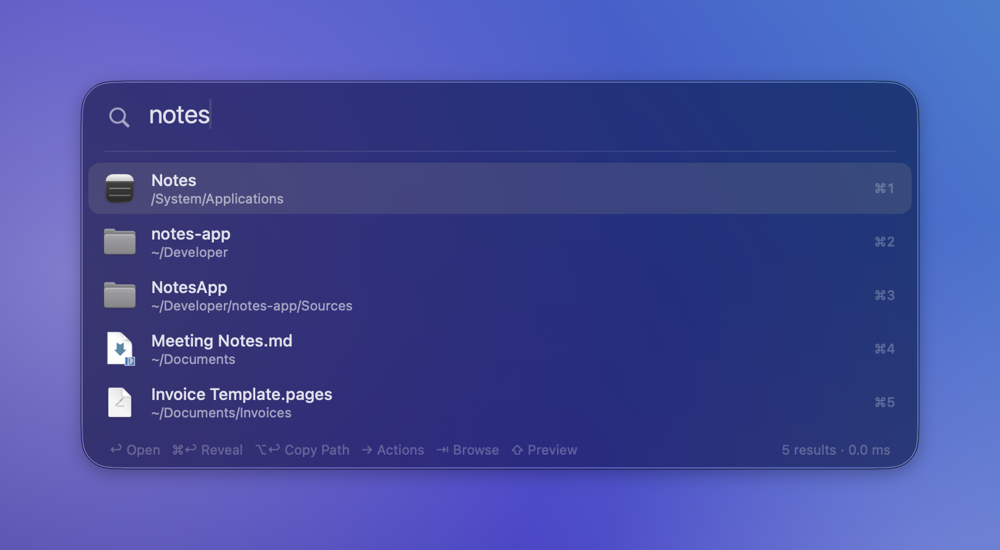
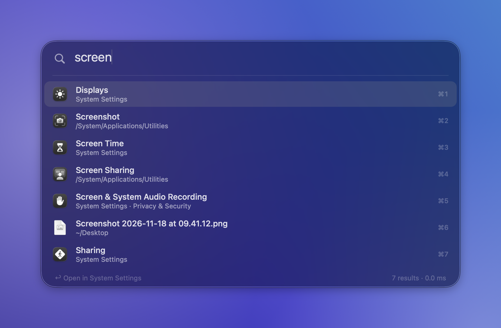
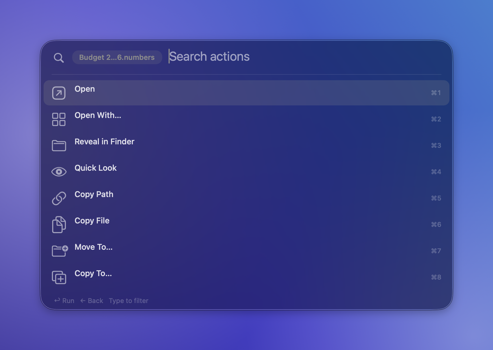
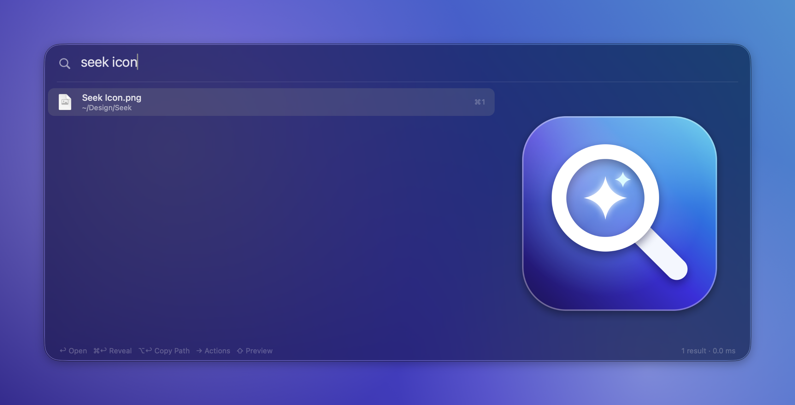
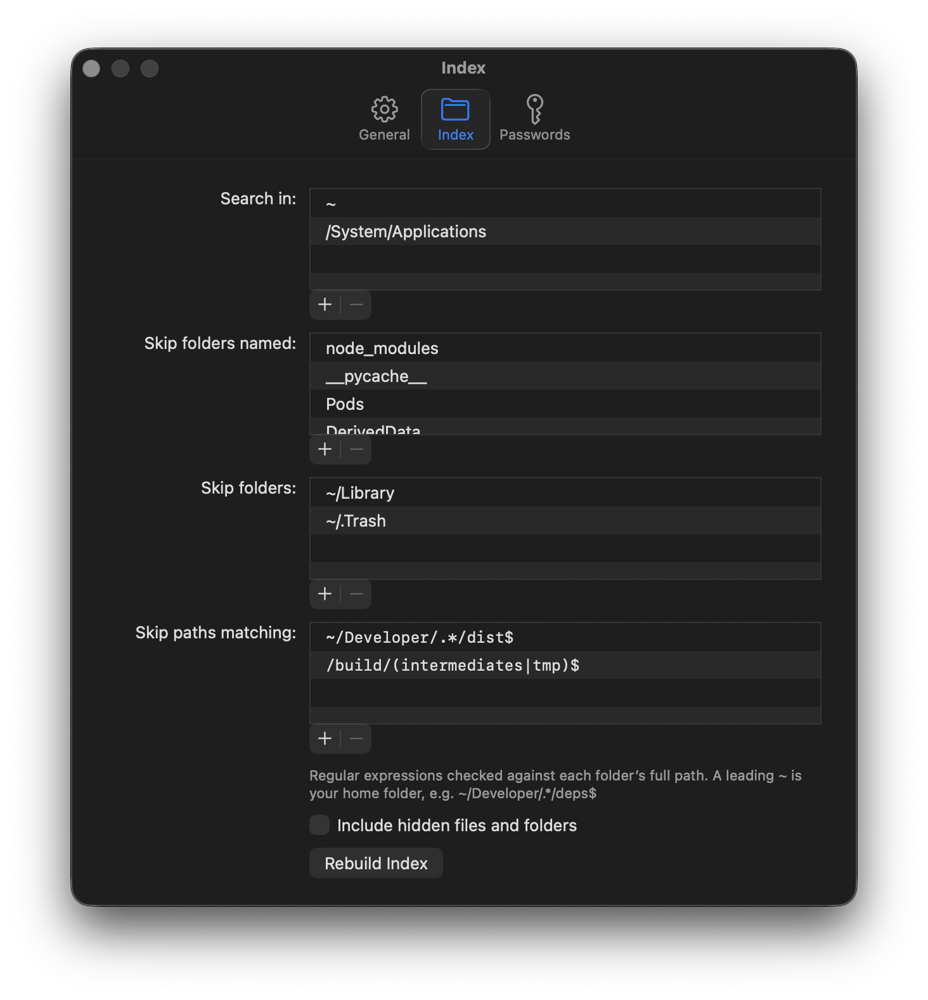

<div align="center">


# Seek

**A fast, keyboard-first launcher for macOS.**<br>
Apps, folders, files and System Settings — found before you finish typing.




</div>

Think Spotlight or Alfred, but with only the parts you use and none of the waiting. Seek keeps its own index in memory, matches on every core, and draws a native **Liquid Glass** panel on macOS 26 Tahoe.

## Highlights

- **Instant results.** A whole-index scan takes a few milliseconds, and each keystroke only rescans the previous matches.
- **Fuzzy matching that gets you.** `vsc` → Visual Studio Code, `inv 24` → invoice-2024.pdf.
- **System Settings, by name.** `keyboard`, `wifi`, `dark mode`, `full disk access` open the right pane.
- **Do things, not just open them.** Move, copy, rename, compress, AirDrop or trash files without leaving the keyboard.
- **Quick Look built in.** Preview any result next to the list.
- **Learns your picks.** The result you choose for a query comes first next time.
- **Passwords shortcut.** `pw github` jumps into Apple Passwords, or copies a login inline with [apw](https://github.com/bendews/apw).
- **Stays out of the way.** No Dock icon, no menu bar icon, no dependencies.

## Install

Requires macOS 13+. Liquid Glass needs **macOS 26 and Xcode 26**; older systems get a frosted-glass look instead.

```sh
xcode-select --install      # if you don't have Xcode or the Command Line Tools
./install.sh                # builds, copies to /Applications and starts Seek
```

Prefer a disk image? `./build.sh --dmg` makes a drag-to-Applications installer in `build/Seek.dmg`.

On first launch Seek indexes your home folder and apps, and macOS asks whether it may access Desktop, Documents and Downloads; allow it. Press **⌘⇧Space** to open Seek. The default leaves Alfred's ⌥Space alone, so you can run both while you switch.

<details>
<summary><b>Keep permissions across rebuilds</b></summary>

<br>

macOS ties Accessibility and folder permissions to an app's signature. Without a fixed signing identity, every rebuild looks like a new app and loses them. Create a local identity once, and `build.sh` uses it from then on:

```sh
Tools/make-signing-cert.sh  # adds a self-signed "Seek Dev" certificate to your login keychain
./install.sh
```

</details>

## Using it

| Keys | What it does |
|---|---|
| type | Fuzzy search |
| ↩ / ⌘↩ / ⌥↩ | Open / Reveal in Finder / Copy path |
| ⌘1 … ⌘9 | Open that row |
| → | Actions for the selection (type to filter) |
| ⇥ | Browse into the selected folder (or type `~/` or `/` to browse from there) |
| ⇧ (tap) or ⌘Y | Quick Look preview |
| ⌥↑ / ⌥↓ | Add the selection to the **file buffer** |
| ⌥→ | Act on everything in the buffer · ⌥← remove last · ⌥⌫ clear |
| ⌘, | Settings |
| drag a row | Drop the file into any app |
| esc | Back / close |

An empty search shows files you recently opened or changed.

### System Settings

Type the name of a settings pane, or something you'd change there, and Seek opens it directly. Panes show their own icons and rank alongside your apps and files.

<p align="center">
  
</p>

| Type | Opens |
|---|---|
| `keyboard`, `key repeat`, `input sources` | Keyboard |
| `displays`, `resolution`, `night shift` | Displays |
| `wifi`, `bluetooth`, `vpn` | Wi-Fi, Bluetooth, VPN |
| `dark mode`, `accent color` | Appearance |
| `dock`, `hot corners`, `stage manager` | Desktop & Dock |
| `full disk access`, `screen recording`, `microphone` | That section of Privacy & Security |

### Actions and Quick Look

Press **→** on any result for Open With, Move To, Copy To, Rename, Trash, Compress, AirDrop, Get Info, Open in Terminal and more. Tap **⇧** to preview the selection.

<table>
  <tr>
    <td width="50%"></td>
    <td width="50%"></td>
  </tr>
  <tr>
    <td align="center"><sub>Actions</sub></td>
    <td align="center"><sub>Quick Look</sub></td>
  </tr>
</table>

### Filters

| Filter | Example |
|---|---|
| Extension | `.pdf tax` · `.key .pptx deck` |
| Kind | `app: code` · `folder: proj` · `file: notes` |
| Modified within | `mod:7d report` · `mod:today` · `mod:12h .png` |
| Inside files (Spotlight) | `in: quarterly revenue` |

### Seek commands

| Type | Does |
|---|---|
| `settings` | Opens Seek's settings (same as ⌘,) |
| `rebuild index` | Re-scans every folder from scratch |
| `reload settings` | Re-reads `config.json` after you edit it by hand |
| `quit seek` | Quits Seek |

If the shortcut ever stops working, open **Seek.app** again from Finder or Spotlight; that opens Settings.

### Passwords

`pw github` opens Apple's **Passwords** app already searching for "github". This needs Accessibility permission: in Settings → Passwords, click **Open Accessibility Settings…** and turn Seek on. If Passwords is locked, unlock it with Touch ID and Seek finishes the search.

<details>
<summary><b>Optional: inline logins with apw</b></summary>

<br>

With [apw](https://github.com/bendews/apw) installed, `pw github` also lists your github.com logins right in Seek:

- ↩ copies the password
- ⌘↩ copies the username
- ⌥↩ copies the 2FA code

Passwords are never displayed. They're marked as concealed so clipboard managers skip them, and they're cleared after 45 seconds.

```sh
brew install bendews/homebrew-tap/apw
brew services start apw     # or "Start apw" in Settings → Passwords
apw auth                    # enter the PIN macOS shows; repeat after each restart
```

apw runs its own hidden copy of Chrome, Brave, Edge or Chromium, so one of them must be installed with the [iCloud Passwords extension](https://chromewebstore.google.com/detail/icloud-passwords/pejdijmoenmkgeppbflobdenhhabjlaj). It doesn't touch your everyday browser profile. apw finds logins by website, so search for the site (`pw github`, `pw linear.app`), not the login's name. apw is a third-party tool; read its README before installing.

</details>

## Settings

Open Settings with **⌘,** in Seek, or type `settings`. Changes save as you make them.

<p align="center">
  
</p>

- **General:** shortcut, visible rows, open at login.
- **Index:** folders to search, and what to skip — by folder name (`node_modules`), by path (`~/Library`), or by a regular expression matched against the full path (`~/Developer/.*/deps$`).
- **Passwords:** keyword, Accessibility status, apw status and location.

<details>
<summary><b>The config file</b></summary>

<br>

Everything is stored in `~/.config/seek/config.json`, which you can also edit by hand (then type `reload settings`):

```json
{
  "hotkey": "cmd+shift+space",
  "roots": ["~", "/Applications", "/System/Applications", "/System/Library/CoreServices/Finder.app"],
  "excludeNames": ["node_modules", "__pycache__", "Pods", "DerivedData", ".build", "venv", ".venv", "bower_components"],
  "excludePaths": ["~/Library", "~/.Trash"],
  "excludePatterns": [],
  "includeHidden": false,
  "visibleRows": 8,
  "passwordsKeyword": "pw",
  "apwPath": ""
}
```

</details>

## Why it's fast

- **It keeps its own index in memory.** Seek doesn't send each keystroke to Spotlight's `mds` daemon. It keeps a compact, column-oriented table of names and matches it directly.
- **Matching runs on every core**, over raw UTF-8 bytes.
- **Typing narrows the search.** Each keystroke that extends the query only rescans the previous matches.
- **The first index walk skips `stat()`.** It uses `fts(3)` with `FTS_NOSTAT`, then keeps up with changes through file-level FSEvents.
- **Startup is instant.** The index is cached on disk and loads at launch, while a background walk catches up.
- **The panel is resident and non-activating.** It opens instantly, and the app you were in stays frontmost.

Measure it on your own Mac. This builds the index from scratch, then times each query in Seek and in `mdfind -name`:

```sh
build/Seek.app/Contents/MacOS/Seek --bench saf invoice "read me" .pdf
```

## Development

```sh
./build.sh                  # build/Seek.app
./install.sh                # build and install to /Applications
Tools/screenshots.sh        # regenerate these screenshots from a fake home folder
```

Plain Swift and AppKit, no third-party dependencies. Seek's data lives in `~/Library/Application Support/Seek/knowledge.json` (what you open) and `~/Library/Caches/Seek/index.bin` (the index cache). See [AGENTS.md](AGENTS.md) for the architecture.

## License

[MIT](LICENSE)
